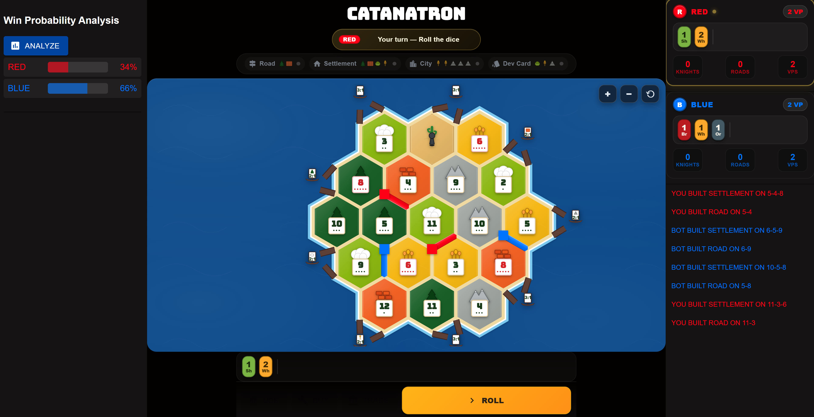

# Catanatron

> **Fork of [catanatron](https://github.com/bcollazo/catanatron) by Bryan Collazo**  
> Original license: GPL-3.0-or-later (preserved)  
> This fork includes experimental RL agents, UI improvements, and additional training infrastructure.

## Rule Changes in This Fork

> [!IMPORTANT]
> Games in this fork follow the official rules more closely than upstream catanatron, so
> results are not directly comparable with upstream's or with agents trained on it.

The engine's rules were checked one by one against the official 5th edition Catan Game
Rules & Almanac. These six differed and were fixed in both the Python engine and the JAX
training simulator:

| Rule | Before | Now |
| --- | --- | --- |
| **Longest Road after a road is cut** | The longest remaining road took the card, even if it was under 5 roads or tied | The Almanac's special case: the holder keeps the card while still tied for longest. Otherwise, the only player with the longest road of 5+ takes it. If nobody qualifies, the card is set aside until someone does |
| **A road ending at an opponent's settlement** | The last road, leading into the settlement, didn't count toward Longest Road | It counts. A settlement only breaks a road when it sits between two of its pieces |
| **Building past an opponent's settlement** | After a settlement cut a loop of roads, the owner could still build onward from the far side of it | Blocked, as with any other cut |
| **When a player wins** | Anyone reaching 10 VP won at once, even during another player's turn | You only win on your own turn. Reaching 10 VP during someone else's turn wins when your turn starts |
| **Bank runs out of a resource** | Nobody received it | Nobody receives it if 2 or more players are owed it. A player who is the only one owed it gets whatever is left |
| **Random number placement** | 6s and 8s could be on adjacent hexes | Re-dealt until no 6 or 8 touches another. The spiral placement already did this |

How often this matters: in 400 four-player games between `ValueFunctionPlayer` bots, the
old rule gave Longest Road to the wrong player in 54 of 198 road cuts, about 13% of games.
In the same games there were 25 shortages with a single claimant and 15 games with a
different road length. One player reached 10 VP during another player's turn.

**Checked by:** each case is scripted in `tests/rules_scenarios.py`. `tests/test_rules.py`
runs those scenarios in the Python engine, and `tests/jax_rl/test_parity.py` runs them in
the JAX simulator. The parity test also checks that both implementations reassign Longest Road the same
way after a cut. It covers every holder and cut for 3 players with road lengths of 3 to 7.

**Still different on purpose:**
- Players discard one at a time after a 7 rather than all at once.
- A game is called a draw after 1,000 turns.

**Effect on trained agents:**
- The site's agents in `agents/` (1v1) were trained under the old rules.
- The 4-player PSRO agent was retrained under the new ones. It was about as strong as
  before ([PSRO4_V2.md](catanatron/catanatron/jax_rl/PSRO4_V2.md)).

Earlier rule fixes came from upstream:
- deterministic discards (#362);
- 6s and 8s kept apart in the spiral placement (#363);
- the Friendly Robber option (#366);
- no building through an opponent's settlement at the end of a road (#377).

## Changes in This Fork

This repository is a local fork of the original [catanatron](https://github.com/bcollazo/catanatron) with the following additions and modifications:

### Trained Agents (`agents/`)
- The PPO and PSRO agents behind the web UI's Easy, Medium and Hard opponents, trained with `jax_rl/`
- Their strength is in the JAX [RESULTS.md](catanatron/catanatron/jax_rl/RESULTS.md)

### Enhanced Web UI (`ui/`) — **Complete Rewrite (new_interface)**

**Before (original):**


- Basic React + Material UI board rendering
- Simple tile display with minimal styling
- Static port representations
- Desktop-only layout

**After (new_interface):**



- **Tile rendering**: True Catan terrain colors matched to reference image (forest, hills, pasture, fields, mountains, desert, sea)
- **Port/boat visualizations**: Animated harbor boats with resource-specific sails, masts, hulls, and dock planks connecting to hex corners
- **Number tokens**: Red highlighting for 6/8, pip dots for probability visualization, flashing animation on roll
- **Responsive layout**: Mobile-friendly homepage with proper scrolling, adaptive board scaling
- **Pieces and cards**: Custom art for roads, settlements, cities and development cards
- **Opponents**: The home page offers the classic bots and the trained PSRO and PPO agents at Easy, Medium and Hard
- **Playing**: An action dock for building, buying and trading with the bank; a dialog for choosing discards; bot speed control; a how-to-play guide with keyboard shortcuts
- **Side panel**: Scoreboard (opponents' hands and hidden VPs stay secret), cards left in the bank, dice roll chart, live win odds with a chart by turn, and a game log that includes discards
- **After a game**: Rematch, game stats, a new game, the replay, or back to the board
- **Classic UI**: The previous interface is kept in `ui-backup/`, linked from the home page

The web server also lists the trained agents (`/api/jax-agents`). SB3 PPO models dropped
into a local `ppo_agents/` folder (gitignored) appear in the player menu too.

### Gymnasium Environment Extensions (`catanatron/catanatron/gym/`)
- New adapters and policies for RL training
- `PPO` player code to load SB3 MaskablePPO models (`PPO:path.zip:vector:BASE:1`)
- Vectorized environment support

### Pure-JAX Training (`catanatron/catanatron/jax_rl/`)
- Game rules for 2 to 4 players reimplemented in JAX and checked move by move against the Python engine
- PPO and PSRO pipelines with no PyTorch or Stable-Baselines3 dependency, trained on a GPU through WSL2
- `JAX` player code to use a trained agent in the engine: `catanatron-play --players=JAX:agents/psro-hard,F`
- Engine tournaments with paired confidence intervals (`python -m catanatron.jax_rl.tournament`)
- Results: the best 1v1 agent beats `ValueFunctionPlayer` (`F`) 74.6% of the time. The 4-player PSRO agent wins 59.5% at a table with three `F` bots, and 42.3% against three JSettlers robots, where an equal player would win 25%
- This is the recommended way to train; see its [README](catanatron/catanatron/jax_rl/README.md), [RESULTS.md](catanatron/catanatron/jax_rl/RESULTS.md), [IMPROVING.md](catanatron/catanatron/jax_rl/IMPROVING.md) and [PSRO4_V2.md](catanatron/catanatron/jax_rl/PSRO4_V2.md)

### Benchmarking Against Published Agents (`catanatron/catanatron/sota/`)
- `HM` player: the LLM-evolved HexMachina players from "Agents of Change" (arXiv:2506.04651), usable anywhere a player code is (`catanatron-play --players=HM,AB`)
- `catanatron-jsettlers`: plays any catanatron player against the JSettlers2 robots on a real JSettlers server
- See its [README](catanatron/catanatron/sota/README.md)

### Legacy Training Scripts (`examples/`, PyTorch + SB3)
- `train_ppo_selfplay.py` - Self-play PPO training
- `train_ppo_custom.py` - Custom reward PPO training
- `train_ppo_pure.py` - Pure PPO baseline
- `universal_runner.py` - Unified training runner

### Game Rules
- Six rules corrected to match the official rules; see [Rule Changes in This Fork](#rule-changes-in-this-fork)

---

Catanatron is a high-performance simulator and strong AI player for Settlers of Catan. You can run thousands of games in the order of seconds. The goal is to find the strongest Settlers of Catan bot possible.

## Command Line Interface

Catanatron provides a `catanatron-play` CLI tool to run large scale simulations.

<p align="left">
 
</p>

### Installation

1. Clone the repository:

   ```bash
   git clone https://github.com/CarterLagasse/catanatron-agents.git
   cd catanatron-agents/
   ```

2. Create a virtual environment (requires Python 3.11 or higher)

   ```bash
   python -m venv venv
   source ./venv/bin/activate
   # ./venv/Scripts/Activate.ps1 (on windows)
   ```

3. Install dependencies

   ```bash
   pip install -e .
   ```

4. (Optional) Install developer and advanced dependencies

   ```bash
   pip install -e ".[web,gym,dev]"
   ```

   For this fork's trained agents and JAX training, also install `".[jax]"`.

### Usage

Run simulations and generate datasets via the CLI:

```bash
catanatron-play --players=R,R,R,W --num=100
```

Generate datasets from the games to analyze:

```bash
catanatron-play --num 100 --output my-data-path/ --output-format json
```

See more examples at https://docs.catanatron.com.

## Web UI (Docker)

Watch, inspect, and play games against Catanatron via the web UI.

### Installation

1. Ensure you have Docker installed (https://docs.docker.com/engine/install/)
2. Run the `docker-compose.yaml` in the root folder of the repo:

   ```bash
   docker compose up
   ```

3. Visit http://localhost:4000 in your browser!

The new UI opens by default. To use the previous one, pick **Classic** at the top
of the home page or go to http://localhost:4001. Its code is in `ui-backup/`.

### Public site

`Dockerfile.deploy` builds the UI and game server into one app, with the trained agents
from `agents/`, for a small host. The host deploys `main` once CI passes. These settings
control it:

| Setting                | Purpose                                              | In the image |
| ---------------------- | ---------------------------------------------------- | ------------ |
| `DATABASE_URL`         | Where games are saved. Set this on the host          | Not set      |
| `SECRET_KEY`           | Flask's secret. Set this on the host                 | Not set      |
| `CATANATRON_UI_DIST`   | Folder of the built UI to serve                      | `/app/ui-dist` |
| `WIN_ODDS_SIMULATIONS` | Fewer make win odds faster but less precise          | 25           |
| `MAX_SAVED_GAMES`      | Older games are deleted beyond this. 0 keeps them all | 50           |

## Python Library

You can also use `catanatron` package directly which provides a core
implementation of the Settlers of Catan game logic.

```python
from catanatron import Game, RandomPlayer, Color

# Play a simple 4v4 game
players = [
    RandomPlayer(Color.RED),
    RandomPlayer(Color.BLUE),
    RandomPlayer(Color.WHITE),
    RandomPlayer(Color.ORANGE),
]
game = Game(players)
print(game.play())  # returns winning color
```

See more at http://docs.catanatron.com

## Gymnasium Interface

For Reinforcement Learning, catanatron provides an Open AI / Gymnasium Environment.

Install it with:

```bash
pip install -e .[gym]
```

and use it like:

```python
import random
import gymnasium
import catanatron.gym

env = gymnasium.make("catanatron/Catanatron-v0")
observation, info = env.reset()
for _ in range(1000):
    # your agent here (this takes random actions)
    action = random.choice(info["valid_actions"])

    observation, reward, terminated, truncated, info = env.step(action)
    done = terminated or truncated
    if done:
        observation, info = env.reset()
env.close()
```

See more at: https://docs.catanatron.com

## Documentation

Full documentation here: https://docs.catanatron.com

## Contributing

To develop for Catanatron core logic, install the dev dependencies and use the following test suite:

```bash
pip install .[web,gym,dev]
coverage run --source=catanatron -m pytest tests/ && coverage report
```

See more at: https://docs.catanatron.com

## Appendix

See the motivation of the project here: [5 Ways NOT to Build a Catan AI](https://medium.com/@bcollazo2010/5-ways-not-to-build-a-catan-ai-e01bc491af17).

---

*License: GPL-3.0-or-later (same as upstream). Original copyright Bryan Collazo.*