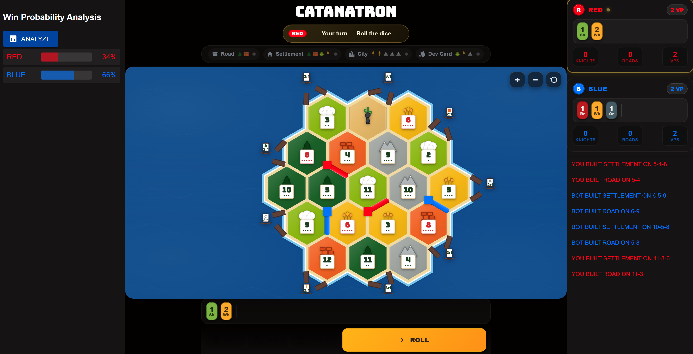

# Catanatron

> **Fork of [catanatron](https://github.com/bcollazo/catanatron) by Bryan Collazo**  
> Original license: GPL-3.0-or-later (preserved)  
> This fork includes experimental RL agents, UI improvements, and additional training infrastructure.

## Changes in This Fork

This repository is a local fork of the original [catanatron](https://github.com/bcollazo/catanatron) with the following additions and modifications:

### Experimental RL Agents (`ppo_agents/`)
- Pre-trained PPO (Proximal Policy Optimization) models for self-play
- Training checkpoints at various iterations (200–5000)
- Custom reward shaping and self-play configurations

### Enhanced Web UI (`ui/`) — **Complete Rewrite (new_interface)**

**Before (original):**


- Basic React + Material UI board rendering
- Simple tile display with minimal styling
- Static port representations
- Desktop-only layout

**After (new_interface):**



- **Tile rendering**: True Catan terrain colors matched to reference image (forest, hills, pasture, fields, mountains, desert, sea)
- **Port/boat visualizations**: Animated harbor boats with resource-specific sails, masts, hulls, and dock planks connecting to hex corners
- **Number tokens**: Red highlighting for 6/8, pip dots for probability visualization, flashing animation on roll
- **Responsive layout**: Mobile-friendly homepage with proper scrolling, adaptive board scaling
- **Component architecture**: Modular SCSS/TypeScript components (Tile, Board, ActionsToolbar, Prompt, Drawers, CostStrip)
- **Interactive elements**: Clickable tiles, action toolbars, phase banners, left/right drawers for game state

### Gymnasium Environment Extensions (`catanatron/catanatron/gym/`)
- New adapters and policies for RL training
- Custom player implementations
- Vectorized environment support

### Training Scripts (`examples/`)
- `train_ppo_selfplay.py` - Self-play PPO training
- `train_ppo_custom.py` - Custom reward PPO training
- `train_ppo_pure.py` - Pure PPO baseline
- `universal_runner.py` - Unified training runner

### Experimental Module (`catanatron_experimental/`)
- Hyperparameter optimization (Optuna, Ray Tune, SPSA)
- MCTS score collection utilities
- CLI players for testing

### Game Logic Fixes
- Deterministic discard handling
- Road/ship building validation
- Friendly robber game option
- Block road extension through opponent settlements

---

Catanatron is a high-performance simulator and strong AI player for Settlers of Catan. You can run thousands of games in the order of seconds. The goal is to find the strongest Settlers of Catan bot possible.

## Command Line Interface

Catanatron provides a `catanatron-play` CLI tool to run large scale simulations.

<p align="left">
 
</p>

### Installation

1. Clone the repository:

   ```bash
   git clone git@github.com:bcollazo/catanatron.git
   cd catanatron/
   ```

2. Create a virtual environment (requires Python 3.11 or higher)

   ```bash
   python -m venv venv
   source ./venv/bin/activate
   # ./venv/Scripts/Activate.ps1 (on windows)
   ```

3. Install dependencies

   ```bash
   pip install -e .
   ```

4. (Optional) Install developer and advanced dependencies

   ```bash
   pip install -e ".[web,gym,dev]"
   ```

### Usage

Run simulations and generate datasets via the CLI:

```bash
catanatron-play --players=R,R,R,W --num=100
```

Generate datasets from the games to analyze:

```bash
catanatron-play --num 100 --output my-data-path/ --output-format json
```

See more examples at https://docs.catanatron.com.

## Web UI (Docker)

Watch, inspect, and play games against Catanatron via the web UI.

### Installation

1. Ensure you have Docker installed (https://docs.docker.com/engine/install/)
2. Run the `docker-compose.yaml` in the root folder of the repo:

   ```bash
   docker compose up
   ```

3. Visit http://localhost:3000 in your browser!

## Python Library

You can also use `catanatron` package directly which provides a core
implementation of the Settlers of Catan game logic.

```python
from catanatron import Game, RandomPlayer, Color

# Play a simple 4v4 game
players = [
    RandomPlayer(Color.RED),
    RandomPlayer(Color.BLUE),
    RandomPlayer(Color.WHITE),
    RandomPlayer(Color.ORANGE),
]
game = Game(players)
print(game.play())  # returns winning color
```

See more at http://docs.catanatron.com

## Gymnasium Interface

For Reinforcement Learning, catanatron provides an Open AI / Gymnasium Environment.

Install it with:

```bash
pip install -e .[gym]
```

and use it like:

```python
import random
import gymnasium
import catanatron.gym

env = gymnasium.make("catanatron/Catanatron-v0")
observation, info = env.reset()
for _ in range(1000):
    # your agent here (this takes random actions)
    action = random.choice(info["valid_actions"])

    observation, reward, terminated, truncated, info = env.step(action)
    done = terminated or truncated
    if done:
        observation, info = env.reset()
env.close()
```

See more at: https://docs.catanatron.com

## Documentation

Full documentation here: https://docs.catanatron.com

## Contributing

To develop for Catanatron core logic, install the dev dependencies and use the following test suite:

```bash
pip install .[web,gym,dev]
coverage run --source=catanatron -m pytest tests/ && coverage report
```

See more at: https://docs.catanatron.com

## Appendix

See the motivation of the project here: [5 Ways NOT to Build a Catan AI](https://medium.com/@bcollazo2010/5-ways-not-to-build-a-catan-ai-e01bc491af17).

---

*License: GPL-3.0-or-later (same as upstream). Original copyright Bryan Collazo.*