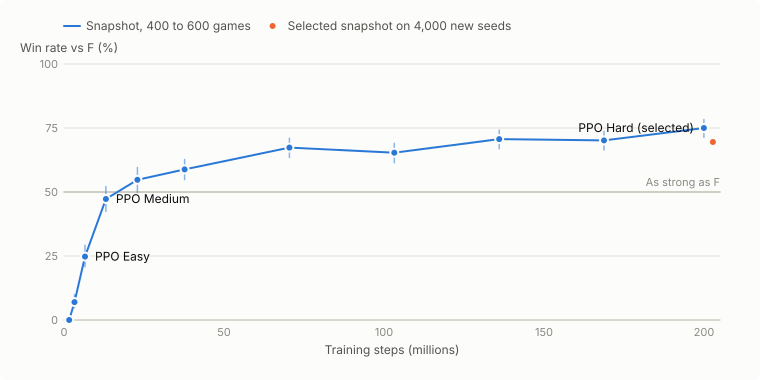
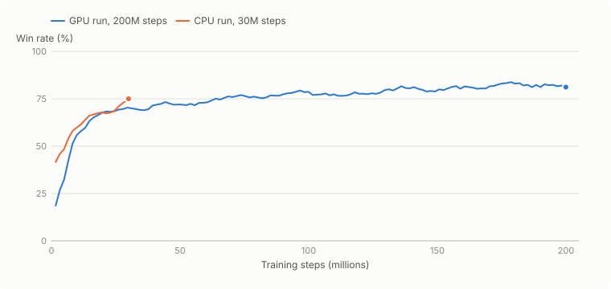
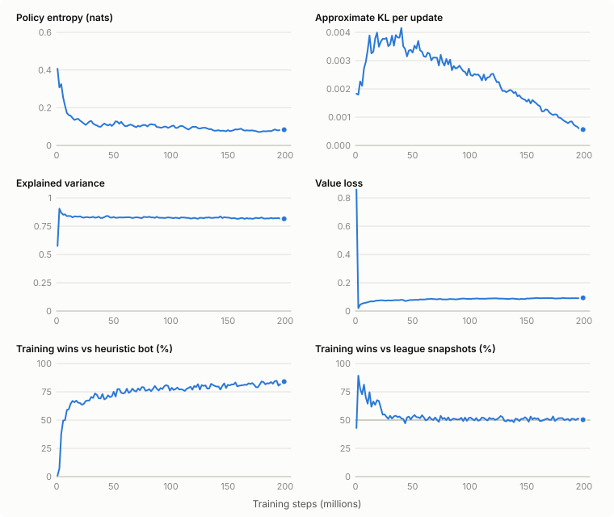
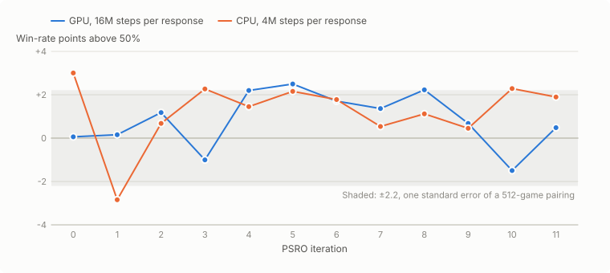
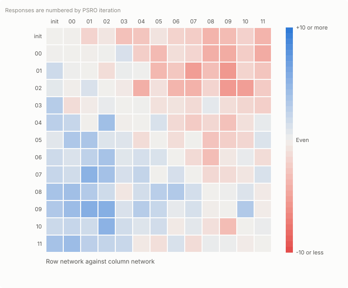
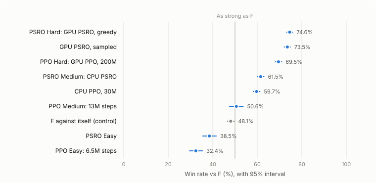

# Improving the JAX agents

This is a guide to making the PPO and PSRO agents stronger. It covers how they converged
during training, where the time goes, how to tell whether a change helped, and what to
try next. [README.md](README.md) explains how to run training and
[RESULTS.md](RESULTS.md) has the final strength of each agent.

Every number here was measured in November 2026, from the logs in `runs/`. That folder is
gitignored, so the figures are committed as images. `plot_training.py` redraws them from
the logs; see [Redrawing the figures](#redrawing-the-figures).

`F` is the engine's `ValueFunctionPlayer` and `AB:2` is `AlphaBetaPlayer` at depth 2. A
50% win rate against `F` means as strong as `F`. All games are 1v1 on the BASE map.

## Summary

- **Most of the strength comes in the first 40M steps.** GPU PPO matched `F` at about
  13M steps, reached 59% against it at 38M and about 70% from 136M on.
- **There's no clear gain after 136M steps.** The 200M checkpoint scored 75.0% when it
  was picked as the best of seven, but 69.5% on 4,000 new seeds. That's no better than
  the 70.7% measured at 136M. RESULTS.md says strength was still rising at the end; once
  selection is accounted for, the evidence for that is weak.
- **By the end of the run, training barely changed the policy.** The learning rate had
  decayed to 1e-4, the KL per update fell to 0.0006 and entropy to 0.08 nats. No one has
  tested whether the plateau comes from this schedule, the network's size or the
  training opponents.
- **The in-simulator check can't tell checkpoints apart.** It plays 128 games against
  the scripted heuristic bot, which flattens near 80% and swings about ±2 points.
  `best.npz` is chosen this way. Choose checkpoints with engine tournaments instead.
- **Faster hardware buys steps, not better learning per step.** The CPU and GPU runs
  follow the same curve for the steps they share.
- **PSRO's gain over PPO hasn't been separated from its extra training.** PSRO Hard
  beats PPO Hard by 5 points against `F` (74.6% vs 69.5%), but it also trained for 192M
  more steps. Each PSRO response beat the mixture before it by at most 2.5 points, which
  is within the noise of how those payoffs were measured.
- **The network uses almost all the compute.** On the CPU, gradients take 69% of the
  time and the forward pass 25%. Simulating the game takes about 5%.

## How training works

### PPO (`ppo.py`)

Each iteration steps 256 games for 128 plies at once, which is 32,768 steps, then makes
one pass of updates over 32 minibatches. Games are split into three groups:

| Group | Share of games | Who plays |
| --- | --- | --- |
| Self-play | 60% | The current network in both seats. Both seats produce training data. |
| League | 25% | The learner against a frozen past snapshot, in a random seat |
| Scripted | 15% | The learner against a JAX bot: 70% heuristic, 15% weighted, 15% random |

About 80% of all decisions are the learner's and go into the update.

- **Reward:** +1 for a win and -1 for a loss. On top of that, the change in VP lead is
  worth 0.05 per point (`shaping_vp`). This is potential-based shaping, so in theory it
  doesn't change which policy is best.
- **Advantages:** GAE runs along each seat's own decisions, because a player makes
  several moves per turn and can discard on the opponent's turn. `gamma` is 0.997 per
  own decision.
- **Schedules:** both run linearly over the whole run. The learning rate falls from 1e-3
  to 1e-4 and the entropy bonus from 0.01 to 0.002.
- **League:** every 50 iterations the current network joins a pool that keeps the last
  12 snapshots, which covers about 20M steps. Four opponents are redrawn from it every
  10 iterations, weighted toward recent snapshots.
- **Checkpoints:** every 50 iterations the run saves `snapshots/it_XXXXX.npz` and plays
  128 games in the simulator against each scripted bot. `best.npz` is the snapshot with
  the best heuristic result.

### PSRO (`psro.py`)

The population starts as the three scripted bots plus an optional warm start, `init`.
Each iteration does four things:

1. Solves the payoff matrix for an approximate Nash mixture, using regret matching+ for
   50,000 iterations. Weights under 0.1% are dropped.
2. Trains a best response with PPO. 80% of its games are against members sampled from
   the mixture and 20% are self-play. The first response starts from `init`, and each
   later one starts from the response before it.
3. Plays the new response against every member in the simulator, with `--eval-envs`
   games per pairing, to fill in its row of the matrix.
4. Logs how much the new response beat the previous mixture by.

The saved agent is the final mixture. In the UI it plays greedily, picking each move's
most likely action.

### Network (`network.py`) and observations (`obs.py`)

- **Shape:** a graph actor-critic with 35,773 parameters (`hidden` 48, `rounds` 3).
  Checkpoints are about 150 KB.
- **Inputs:** each node, edge and tile has its own embedding, plus one for global
  state, with 19, 3, 9 and 60 input features. Messages follow the board's real adjacency
  and are summed, which keeps the cost per round at hidden² for each part of the board.
- **Outputs:** placement logits come from the node, edge or tile they refer to, and
  everything else comes from the global vector. There are 273 actions in all.
- **Hidden information:** observations are from the player's own point of view. The
  opponent's hand and dev cards appear only as counts, and `tests/jax_rl/test_env.py`
  checks that nothing hidden leaks.

## Convergence and performance over time

### Strength in the real engine

<picture>
  <source media="(prefers-color-scheme: dark)" srcset="figures/strength-over-training-dark.svg">
  
</picture>

These are snapshots of the 200M-step GPU PPO run, played in the Python engine against
`F`. The lines through each point are 95% intervals. The first five snapshots played 400
games each and the rest 600. Every snapshot in a group played the same seeds, so points
within a group can be compared directly.

<details>
<summary>The numbers behind this figure</summary>

| Iteration | Steps | Games | Win rate vs `F` (95% interval) |
| --- | --- | --- | --- |
| 50 | 1.6M | 400 | 0.0% (0.0–1.0) |
| 100 | 3.3M | 400 | 7.0% (4.9–9.9) |
| 200 (PPO Easy) | 6.6M | 400 | 24.8% (20.8–29.2) |
| 400 (PPO Medium) | 13.1M | 400 | 47.2% (42.4–52.1) |
| 700 | 22.9M | 400 | 54.8% (49.9–59.6) |
| 1150 | 37.7M | 600 | 58.8% (54.9–62.7) |
| 2150 | 70.5M | 600 | 67.3% (63.5–71.0) |
| 3150 | 103.2M | 600 | 65.3% (61.4–69.0) |
| 4150 | 136.0M | 600 | 70.7% (66.9–74.2) |
| 5150 | 168.8M | 600 | 70.2% (66.4–73.7) |
| 6103 (PPO Hard) | 200.0M | 600 | 75.0% (71.4–78.3) |
| 6103, retested on new seeds | 200.0M | 4000 | 69.5% (68.1–70.9) |

The first five rows come from `runs/levels/calibration` and the rest from
`runs/gpu/selection`. PPO Easy and Medium were later retested on 1,000 new seeds, scoring
32.4% and 50.6%.

</details>

What it shows:

- **Fast early learning.** PPO goes from losing every game to matching `F` in about 13M
  steps. On the GPU that's under 6 minutes.
- **A plateau near 70%.** After 136M steps the measured points stay within each other's
  intervals.
- **Selection inflates scores.** The 200M point is high partly because it was picked for
  being high. Only the retest, at 69.5%, is a fair estimate.

### The in-simulator check

<picture>
  <source media="(prefers-color-scheme: dark)" srcset="figures/simulator-eval-dark.svg">
  
</picture>

This is the check `ppo.py` runs every 50 iterations: 128 simulator games against the JAX
heuristic bot. The lines are moving averages over 5 checks. Individual checks sit about
2.2 points either side of that average.

What it shows:

- **Steps matter, not speed.** The CPU run (seed 0) and the GPU run (seed 1) follow nearly
  the same curve for the 30M steps they share. The GPU just goes much further.
- **This check is a poor ranking signal.** From 70M steps on, single checks range from
  72% to 87% with no clear order, while engine strength over the same span only moves
  between 65% and 71%. Its noise is as large as the real differences, so `best.npz` is
  close to a random pick among late checkpoints. Over the last 1,000 iterations the run
  also won 82% of its 15,004 training games against this bot, so it has little left to
  teach.

### Training diagnostics

<picture>
  <source media="(prefers-color-scheme: dark)" srcset="figures/training-diagnostics-dark.svg">
  
</picture>

These come from `runs/gpu/ppo/metrics.jsonl`, averaged over windows of 50 iterations (1.6M
steps).

| Measure | First 50 iterations | Last 50 iterations | What to watch for |
| --- | --- | --- | --- |
| Policy entropy | 0.41 nats | 0.08 nats | A fall to near 0 while strength is still flat means the policy has stopped exploring |
| Approximate KL | 0.0018 | 0.0006 | Over about 0.02 means updates are too large; near 0 means the policy has stopped changing |
| Explained variance | 0.58 | 0.82 | Below 0.5 late in a run means the value head isn't keeping up |
| Value loss | 0.86 | 0.09 | A rise late in a run usually comes with falling explained variance |
| Training wins vs heuristic bot | n/a | 84% of 732 games | A drop means the policy got worse at basics |
| Training wins vs league | n/a | 50% of 1,777 games | Should sit at or a little over 50% |
| Game length | 704 plies | 210 plies | Long games mean weak play, or games hitting the tick limit |

A few things stand out:

- **KL peaked around 40M steps, then declined as the learning rate decayed.** By the last
  50 iterations it was about a seventh of its peak, which fits the plateau in engine
  strength.
- **Explained variance flattened at about 0.82 by 10M steps.** Dice keep any value
  estimate from being exact, so this may be close to the limit. A wider network is the
  way to find out.
- **League win rate pinned at 50% isn't a problem in itself.** The league is made of
  recent copies of the learner. It only means the learner isn't pulling away from its
  own recent past.

### PSRO

<picture>
  <source media="(prefers-color-scheme: dark)" srcset="figures/psro-response-gains-dark.svg">
  
</picture>

Each point is how much a new best response beat the mixture it was trained against, in
win-rate points above 50%. A clear positive value means the old mixture could still be
exploited.

What it shows:

- **The gains never shrink.** They stay between about -3 and +3 points across all 12
  iterations of both runs, so this measure shows no sign of PSRO converging.
- **The gains are about the same size as the noise.** One pairing measured over 512 games
  has a standard error of 2.2 points. That's the shaded band, and it's 4.4 points for
  the CPU run's 128 games. Averaging over several mixture members shrinks this somewhat,
  but the payoffs that set the mixture are mostly noise at this precision.
- **`exploitability_within_population` in `population.json` stays near 0 by design.** It
  only checks members already in the population, so it can't show convergence.

<picture>
  <source media="(prefers-color-scheme: dark)" srcset="figures/psro-payoffs-dark.svg">
  
</picture>

These are the payoffs between the GPU run's networks, as win-rate points for the row
network against the column network, from 512 simulator games per pairing. Later
responses mostly beat earlier ones, but by at most 5.6 points. Every network beat the
random and weighted bots in at least 99.9% of games and the heuristic bot in 82% to 86%.

The final GPU mixture is:

| Member | Weight |
| --- | --- |
| `br_11` | 48.5% |
| `br_08` | 39.2% |
| `br_07` | 12.0% |
| `br_09` | 0.3% |

### Final strength

<picture>
  <source media="(prefers-color-scheme: dark)" srcset="figures/final-strength-dark.svg">
  
</picture>

These are engine win rates against `F` on seeds not used for selection: 4,000 games for
the main agents and 1,000 for the Easy and Medium levels. `F` against itself is the
control, and should land near 50%. RESULTS.md has the head-to-head results and the
comparisons against `AB:2`.

## Where the time goes

| Measurement | Value | Source |
| --- | --- | --- |
| GPU training, RTX 4050 Laptop | About 39,000 steps/s | Median iteration time in `runs/gpu/ppo/metrics.jsonl` |
| CPU training, Core Ultra 7 155H | About 2,700 steps/s | `benchmark.py`, November 2026 |
| GPU PPO, 200M steps | About 1.6 hours of compute | The run took 4.9 hours, but the laptop slept for 3.2 of them |
| GPU PSRO, 12 responses of 16M steps | About 1.3 hours | `history` in `population.json` |
| Engine evaluation, 6 workers | Roughly 5 to 10 games/s | File times in `runs/gpu/selection` and `runs/eval_final` |

Cost per game state on the CPU, from `python -m catanatron.jax_rl.benchmark`:

| Step | Microseconds | Share |
| --- | --- | --- |
| Gradient | 242.3 | 69% |
| Network forward pass | 88.2 | 25% |
| Encode observation | 9.0 | 3% |
| Game step | 8.0 | 2% |
| Legal-move mask | 1.4 | under 1% |

Some consequences:

- **Network width sets the speed.** Cost grows with hidden². Doubling `--hidden` to 96
  should make each step roughly 3 to 4 times slower on the CPU. The GPU may slow down
  less; measure it with `benchmark.py --hidden 96`.
- **Reusing data costs as much as collecting it.** Simulating is cheap, so one update
  epoch on fresh data is the right default. Extra epochs cost almost as much as new
  data.
- **More parallel games don't help on the GPU.** 1,024 games ran at 38,000 steps/s
  against 43,000 for 256, because every sample still needs a gradient.
- **Evaluation is the slow part of an experiment.** A 4,000-game match against `F` takes
  around 10 minutes on the CPU, about the time the GPU needs for 20M training steps.

## How to tell whether a change helped

The simulator check is too noisy and too easy to rank changes by. Use the engine and
`tournament.py`:

```bash
python -m catanatron.jax_rl.tournament --run-dir runs/eval_myidea --seed 300000 \
    --agent baseline=runs/gpu/ppo/selected.npz:1 --agent idea=runs/myidea/selected.npz:1 \
    --agent F-control=bot:F --vs F=4000 --vs AB:2=1000
```

1. **Pick checkpoints on one set of seeds and report them on another.** In the PPO Hard
   example, a checkpoint scored 75.0% in selection and 69.5% on new seeds. Use a fresh
   `--seed` range for final numbers.
2. **Compare agents on the same seeds.** `tournament.py` does this automatically, and
   its report gives the paired difference with an interval. If the interval includes 0,
   the games can't tell the two apart.
3. **Play enough games for the difference you're looking for:**

   | Games | 95% interval near 60% |
   | --- | --- |
   | 600 | ±3.9 points |
   | 1,000 | ±3.0 points |
   | 2,000 | ±2.2 points |
   | 4,000 | ±1.5 points |

   Paired comparisons need somewhat fewer games than these suggest. A real gain of 2
   points still needs about 4,000.
4. **Keep the control.** `F-control` must land near 50%. It has measured 48.1% to 49.5%,
   so the agent's side may be favored by 1 to 2 points in bot matches. That doesn't
   affect paired comparisons.
5. **Change one thing at a time,** and train the baseline with the same budget.
6. **Use more than one training seed for close calls.** Every setup so far has one seed,
   so seed-to-seed variation is unknown. For a difference under about 3 points, train
   two seeds of each.
7. **Check the opponent spread.** Against the random and weighted bots everything wins
   100%, so they only catch broken agents. `F` and `AB:2` measured about equal (49.9%),
   so both are useful, and beating one says much the same about the other.

## What to try next

These are ranked by what they'd tell us for their cost.

### 1. Pick checkpoints in the engine

- **Why:** `best.npz` is picked by the simulator check, which can't separate late
  checkpoints.
- **How:** after a run, play every fifth snapshot from the last half against `F` for 400
  to 600 games, keep the top three, then retest them on 2,000 new seeds. This could be
  automated as a `--select` step at the end of `ppo.py`.
- **Cost:** about 30 to 60 minutes of CPU time per run.

### 2. Run PPO for as many steps as PSRO used

- **Why:** this decides whether PSRO's 5-point gain comes from the algorithm or from 192M
  extra steps with a fresh learning-rate schedule.
- **How:** train PPO for 392M steps, about what the GPU PSRO pipeline used in total, then
  compare it to PSRO Hard on the same seeds. To isolate the warm restart, also resume
  from `selected.npz` for 192M steps with a fresh schedule.
- **Cost:** about 3 hours of GPU time.

### 3. Lengthen the learning-rate schedule

- **Why:** the plateau lines up with the learning rate decaying to 1e-4 and the KL
  falling to 0.0006.
- **How:** start a run with `--timesteps 600000000`, which stretches both schedules, or
  raise `final_learning_rate` in `PPOConfig`; it isn't a command-line flag.
  `--resume` with a larger `--timesteps` also re-stretches the schedules. A 200M run
  resumed as a 400M one jumps from 1e-4 back to about 5.5e-4.
- **Cost:** 3 to 5 hours of GPU time.
- **Read it by:** the engine curve from step 1. If strength rises past about 72% on new
  seeds, the schedule was the limit.

### 4. Measure PSRO payoffs precisely before adding iterations

- **Why:** payoffs measured over 512 games carry ±2.2 points of noise per pairing,
  about the size of each response's gain.
- **How:** set `--eval-envs 2048`, for about ±1.1 points. Payoff games need forward
  passes only, so this should add little to each iteration on the GPU; check the
  iteration times in the log. Add iterations or longer responses
  (`--response-timesteps`) only once the gains stand clearly above the noise.

### 5. Train against stronger opponents

- **Why:** the strongest training opponent is the JAX heuristic bot, which the learner
  beats more than 80% of the time. `F` and `AB:2` are what the agents are measured against, but
  neither runs inside training.
- **How:** port `F`'s value function to JAX in `bots.py`, then give it a share of the
  scripted games (`scripted_fraction` and `heuristic_share` in `PPOConfig`). It must stay
  jittable and use only legal information.
- **Cost:** a day or two of work. This is the largest change listed, and probably the
  most promising one for strength against the engine's bots.

### 6. Try a wider or deeper network

- **Why:** explained variance has been flat since 10M steps, and the network is tiny at
  36K parameters.
- **How:** run `--hidden 64` or `96`, or `--rounds 4`, with the same wall-clock budget
  instead of the same steps, since each step costs more.
- **Watch:** the public site runs on a 0.1-CPU, 512 MB host. All six agents plus win odds
  peaked at 419 MB, and each agent's first move took 21 to 53 seconds there. Measure a
  bigger agent under the same limits before shipping it; see
  [Shipping an agent](#shipping-an-agent-to-the-site).

### 7. Tune the reward and discount

- **Why:** `shaping_vp` (0.05) and `gamma` (0.997 per own decision) were set once and
  never swept.
- **How:** try `--shaping-vp 0` and `0.1`. Games end around 210 plies, so a lower
  `gamma` is worth one run.

### 8. Look for exploits

- **Why:** no opponent has been trained specifically to beat the final agents, so how
  exploitable they are is unknown.
- **How:** train a fresh response against frozen PSRO Hard alone, using PSRO's
  `train_response` with a one-member population. This needs a small script. A large win
  rate in the engine would show a weakness and give a new member for the next run.

## Pitfalls

- **The 1v1 agents were trained under the old rules.** Six rules have since been corrected
  (see the main README), including two quirks the agents may rely on: Longest Road
  re-awarded under 5 roads after a cut, and building onward from behind an enemy
  settlement that cut a loop. Retrain before comparing new 1v1 runs with them.
- **Rule changes need the parity tests.** Change the engine and `env.py` together. Add the
  case to `tests/rules_scenarios.py`, then run `tests/test_rules.py` and
  `tests/jax_rl/test_parity.py`. The parity test replays engine games through JAX and
  compares the full state and legal moves after every action.
- **The league has a short memory.** It keeps the last 12 snapshots, about 20M steps,
  weighted toward recent ones, so nothing stops the learner from forgetting how to beat
  older strategies. Raising `pool_capacity` is cheap to try.
- **`runs/` isn't in git.** Copy checkpoints you care about somewhere else, and copy
  shipped agents into `agents/`.
- **On Windows, JAX runs on the CPU only.** Train on the GPU under WSL2; RESULTS.md has
  the setup. For evaluation matching the published numbers, set `JAX_PLATFORMS=cpu` and
  `XLA_FLAGS="--xla_cpu_multi_thread_eigen=false intra_op_parallelism_threads=1"`.
- **Use relative paths in `--players`,** because a Windows drive colon splits the player
  spec.
- **Resuming changes the schedules if the step count changes.** See
  [item 3](#3-lengthen-the-learning-rate-schedule).

## Shipping an agent to the site

1. **Copy the agent into `agents/`.** A PPO agent is one `.npz` file. A PSRO agent is a
   folder with `population.json`, `psro_config.json`, `init.npz` and every `br_XX.npz`.
   Everything in `agents/` is public in the repository.
2. **Add an entry to `JAX_AGENTS`** in `catanatron/catanatron/web/api.py`, with its label,
   group, level and win rate against `F`. The menu lists an agent only if its file
   exists.
3. **Measure its win rate against `F`** on at least 1,000 new seeds with `tournament.py`,
   and add the result to the levels table in RESULTS.md.
4. **Check that it fits the free host.** Build `Dockerfile.deploy` and run it with
   `--cpus=0.1 --memory=512m`, against a throwaway Postgres. Then play a full game and
   watch memory and how long the first move takes. The current six agents peaked at 419
   MB of 512.

## Redrawing the figures

From the repository root, with the logs in `runs/`:

```bash
PYTHONPATH=catanatron python -m catanatron.jax_rl.plot_training --runs runs \
    --out catanatron/catanatron/jax_rl/figures
```

It uses only the standard library and writes a light and a dark SVG for each figure.
The markdown shows whichever matches the reader's theme. It reads:

- `runs/gpu/ppo/metrics.jsonl` and `runs/ppo/metrics.jsonl`
- `runs/levels/calibration/summary.json` and `runs/gpu/selection/summary.json`
- `runs/eval/summary.json` and `runs/levels/confirm/summary.json`
- `runs/gpu/psro/population.json` and `runs/psro/population.json`

To add a figure for a new run, write a function in `plot_training.py` and add it to
`FIGURES`.
